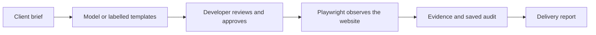

# Briefstamp

Turn a client brief into approved browser checks and a proof-of-delivery report.

Formerly FlowProof; existing repository and demo URLs are retained.

[](https://github.com/himanshu748/flowproof-web/actions/workflows/audit.yml) [](LICENSE)


*Recorded template workflow; actual browser results. [Comparison screenshot](docs/evidence/acceptance-comparison.jpg).*

[Try the live demo](https://flowproof-demo.onrender.com/#demo) · [68-second video](https://youtu.be/xve020VJl0s) · [Three-minute judge guide](docs/JUDGE_GUIDE.md)

[MP4 backup](https://raw.githubusercontent.com/himanshu748/flowproof-web/main/docs/demo/briefstamp-demo.mp4) · [Video provenance and captions](docs/demo/README.md).

## The problem

A site can look finished while a promised headline, contact link or mobile layout is wrong. Freelancers assemble screenshots and test notes while clients try to match the delivery to the brief. Briefstamp joins each requirement, approved check and browser observation in one portable report.

## How it works



## Measured results

| Evidence | Observed result | Receipt |
|---|---|---|
| CI fixture: healthy | **5 passed / 0 failed / 1 unverified** | [Browser execution](docs/evidence/ci-regression-2026-10-15.json) |
| CI fixture: broken | **1 passed / 4 failed / 1 unverified** | [Same approved plan](docs/evidence/ci-regression-2026-10-15.json) |
| CI fixture: restored | **5 passed / 0 failed / 1 unverified** | [Four recoveries](docs/evidence/ci-regression-2026-10-15.json) |
| Tinker LoRA vs few-shot | **69.55% fewer input tokens**; reference agreement **22/24 vs 23/24** | [Cost/quality comparison](docs/MODEL_RESULTS.md) |
| Verification | **571 application tests, 19 Python tests, build** | [CI receipt](docs/evidence/dashboard/2026-10-16/ci.json) · [Run](https://github.com/himanshu748/flowproof-web/actions/runs/38884672613) |

On October 16, Google-hosted Gemma proposed the live-homepage plan: **5 passed / 0 failed / 1 unverified**; its wrong-heading control recorded **4 / 1 / 1**. Both audits round-tripped through Tiger. [Fresh model-to-browser receipt](docs/evidence/hosted-website/2026-10-16T09-10-55Z/receipt.json).

## Integrations with receipts

- **Gemma:** a dated hosted run generated six unapproved checks. [Proof](docs/PUBLIC_GEMMA.md).
- **Mastra:** two actual workflow steps generated and validated that proposal. [Proof](docs/PUBLIC_GEMMA.md).
- **Tinker:** real baseline/LoRA evaluation and one protected hosted proposal. [Proof](docs/HOSTED_TINKER.md).
- **Tiger Data:** strict-TLS audit persistence, matching reads and scoped lexical retrieval. [Proof](docs/TIGER_VERIFICATION.md).
- **Sentry:** the new live Gemma proposal’s three spans were independently verified in its dashboard. [Proof](docs/SENTRY_HOSTED.md).
- **Backboard:** one protected hosted write/search recovered all six audit facts. [Proof](docs/BACKBOARD_VERIFICATION.md).
- **Temporal:** a hosted CI restart retained the same workflow/run and one browser execution. [Proof](docs/TEMPORAL.md).
- **SerpApi and ElevenLabs:** protected hosted search and a real, independently decoded synthetic report MP3. Listening remains unverified. [Proof and audio](docs/HOSTED_OPTIONAL.md).

## Run locally

```sh
npm ci --legacy-peer-deps
npx playwright install chromium
npm run dev
```

Open http://127.0.0.1:5173. The default sample needs no paid account. [Configuration and deployment](docs/DEPLOYMENT.md).

[Delivery workspace design and desktop/mobile verification](docs/DASHBOARD_DESIGN.md).

## Limitations

- Public targets are the owned homepage and sample; scripts are disabled. The public sample’s plan yields three failures, versus four in the CI fixture.
- The video uses labelled templates. Earlier provider and validation failures remain in the [Gemma diagnosis](docs/GEMMA_LIVE_SITE.md); a dated success is no uptime guarantee.
- Tinker used fewer tokens with lower reference agreement; the dataset has no human-validated examples.
- Credit-funded services expire. Tiger stores image references only; budgets and sessions are bounded. Sentry verification covers proposal generation. Optional search, speech and memory proofs are operator-only and their demonstration allowances are consumed. [Current funding boundaries](docs/PROVIDER_ALLOWANCES.md).
- The author reports that freelancer friend Priyanshu tried Briefstamp and said “it's good.” [Workflow details and willingness to pay remain unknown](docs/CUSTOMER_VALIDATION.md); this is not independently observed customer acceptance. All-sponsor completion is not claimed. [Full scope and remaining gates](docs/PRD_STATUS.md).

## AI disclosure

AI coding assistance helped build Briefstamp. Model proposals require approval; deterministic browser execution supplies the results. Retained test approvals came from a verification harness, not a customer. The submission remains a draft for the author to review and publish.
