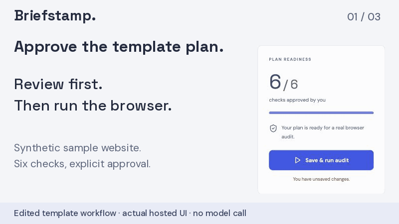
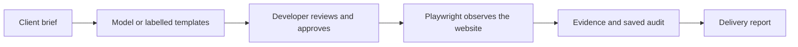

# Briefstamp

Turn a client brief into approved browser checks and a proof-of-delivery report.

Formerly FlowProof; existing repository and demo URLs are retained.

[](https://github.com/himanshu748/flowproof-web/actions/workflows/audit.yml) [](LICENSE)



*Recorded template workflow; actual browser results. [Comparison screenshot](docs/evidence/acceptance-comparison.jpg).*

[Try the live demo](https://flowproof-demo.onrender.com/#demo) · [68-second video](https://youtu.be/xve020VJl0s) · [Three-minute judge guide](docs/JUDGE_GUIDE.md) · [DEV entry](https://dev.to/himanshu_748/briefstamp-proof-at-the-website-handoff-1ac1)

[MP4 backup](https://raw.githubusercontent.com/himanshu748/flowproof-web/main/docs/demo/briefstamp-demo.mp4) · [Video provenance and captions](docs/demo/README.md).

## The problem

A site can look finished while a promised headline, contact link or mobile layout is wrong. Freelancers assemble screenshots and test notes while clients try to match the delivery to the brief. Briefstamp joins each requirement, approved check and browser observation in one portable report.

## How it works



## Measured results

| Evidence | Observed result | Receipt |
|---|---|---|
| CI fixture: healthy | **5 passed / 0 failed / 1 unverified** | [Browser execution](docs/evidence/ci-regression-2026-10-15.json) |
| CI fixture: broken | **1 passed / 4 failed / 1 unverified** | [Same approved plan](docs/evidence/ci-regression-2026-10-15.json) |
| CI fixture: restored | **5 passed / 0 failed / 1 unverified** | [Four recoveries](docs/evidence/ci-regression-2026-10-15.json) |
| Tinker LoRA vs few-shot | **69.55% fewer input tokens**; reference agreement **22/24 vs 23/24** | [Cost/quality comparison](docs/MODEL_RESULTS.md) |
| Public evidence agent (tokenless HTTP) | **3 stored failures + 0 search matches**, cited by two actual Gemma responses; source audit **2/3/1** | [Public-route receipt](docs/evidence/judge-agent/2026-10-16T13-07-24Z/attempt-2/agent-run.json) |
| Verification | **963 application tests, 19 Python tests, build and real Chromium audits** | [CI receipt](docs/evidence/judge-agent/2026-10-16T13-07-24Z/ci.json) · [Run](https://github.com/himanshu748/flowproof-web/actions/runs/38908327718) |

On October 16, Google-hosted Gemma proposed the live-homepage plan: **5 passed / 0 failed / 1 unverified**; its wrong-heading control recorded **4 / 1 / 1**. Both audits round-tripped through Tiger. [Fresh model-to-browser receipt](docs/evidence/hosted-website/2026-10-16T09-10-55Z/receipt.json).

A separate [hosted evidence-agent run](docs/evidence/hosted-evidence-agent/2026-10-16T12-14-14Z/receipt.json) used two native Gemma requests to select Tiger failure history and SerpApi search, then cite their actual results. Tiger returned three saved failures; search returned zero matching results. The source audit stayed **2 passed / 3 failed / 1 unverified**. [Scope, earlier failures and consumed allowances](docs/HOSTED_OPTIONAL.md).

## Optional: public evidence agent

The main sample demo works without this optional step. [Try Tiger + SerpApi](https://flowproof-demo.onrender.com/#agent): approve the fixed checks, run the browser audit, then consent to Gemma investigating the results. [Retained public receipts](docs/evidence/judge-agent/2026-10-16T13-07-24Z/) · [Steps and limits](docs/JUDGE_GUIDE.md#optional-public-evidence-agent).

Providers can fail: of four retained public attempts, one completed, two returned Google HTTP 500, and one had a search timeout. The shared allowance is capped at **100 runs total, six/hour and one/session**, ending **October 20, 2026 at 00:00 UTC**; failed reservations stay spent. [Free allowance check](docs/evidence/judge-agent/2026-10-16T14-14-32Z/funding.json) · [Live expansion readback](docs/evidence/judge-agent/2026-10-16T14-14-32Z/verification.json).

## Integrations with receipts

- **Gemma:** a dated hosted run generated six unapproved checks; a separate native JSON tool loop selected and cited stored history and search observations. [Proposal proof](docs/PUBLIC_GEMMA.md) · [Agent proof](docs/HOSTED_OPTIONAL.md).
- **Mastra:** two actual workflow steps generated and validated that proposal. [Proof](docs/PUBLIC_GEMMA.md).
- **Tinker:** real baseline/LoRA evaluation and one protected hosted proposal. [Proof](docs/HOSTED_TINKER.md).
- **Tiger Data:** strict-TLS persistence and one SQL full-text/pgvector cosine query fused with RRF. A stored `vector(384)` column and valid DiskANN index are verified; the bounded query uses exact rankings. [Migration, real query and independent scores](docs/evidence/tiger-pgvector/2026-10-16T16-16-50Z/) · [Scope](docs/AGENT_RETRIEVAL.md).
- **Sentry:** the new live Gemma proposal’s three spans were independently verified in its dashboard. [Proof](docs/SENTRY_HOSTED.md).
- **Backboard:** one protected hosted write/search recovered all six audit facts. [Proof](docs/BACKBOARD_VERIFICATION.md).
- **Temporal:** the full evidence-agent workflow recovered from injected failures and worker death in real CI; permanent errors failed honestly. Provider responses were retained fixtures; no public judge allowance was used. [Histories and receipt](docs/evidence/temporal-agent/2026-10-16T16-05-48Z/) · [Scope](docs/TEMPORAL.md).
- **SerpApi and ElevenLabs:** agent-selected search in the public walkthrough and a protected, independently decoded synthetic report MP3. Listening remains unverified. [Proof and audio](docs/HOSTED_OPTIONAL.md).

## Run locally

```sh
npm ci --legacy-peer-deps
npx playwright install chromium
npm run dev
```

Open http://127.0.0.1:5173. The default sample needs no paid account. [Configuration and deployment](docs/DEPLOYMENT.md).

[Delivery workspace design and desktop/mobile verification](docs/DASHBOARD_DESIGN.md).

## Limitations

- Public targets are the owned homepage and sample; scripts are disabled. The public sample’s plan yields three failures, versus four in the CI fixture.
- The video uses labelled templates. Earlier provider and validation failures remain in the [Gemma diagnosis](docs/GEMMA_LIVE_SITE.md); a dated success is no uptime guarantee.
- Live provider reliability remains unresolved: the [four retained public attempts](docs/evidence/judge-agent/2026-10-16T13-07-24Z/receipt.json) include two Google HTTP 500 failures and a search timeout with unknown upstream completion; one tokenless HTTP run completed. The app preserves unavailable states and spent slots. The [optional agent](#optional-public-evidence-agent) uses at most two model requests and one search per run. Three fixed queries and precomputed exact-text MiniLM embeddings do not establish arbitrary-query retrieval, hosted embedding inference or a general benchmark. Empty searches are not acceptance verdicts; Mastra remains the separate proposal workflow.
- Tinker used fewer tokens with lower reference agreement; the dataset has no human-validated examples.
- Credit-funded services expire. Tiger stores image references rather than image bytes, with an October 20 access cutoff; budgets and sessions are bounded. Sentry verification covers proposal generation. Earlier optional search, speech, memory and all four operator-agent allowances remain consumed; the separate judge grant cannot replenish them. [Current funding boundaries](docs/PROVIDER_ALLOWANCES.md).
- The author reports that freelancer friend Priyanshu tried Briefstamp and said he “can pay” for it. No price was named; no transcript or recording exists. This is not independently observed customer acceptance, and he is not a paying customer. [Corrected account, October 16, 2026](docs/CUSTOMER_VALIDATION.md). All-sponsor completion is not claimed. [Full scope and remaining gates](docs/PRD_STATUS.md).

## AI disclosure

AI coding assistance helped build Briefstamp. Model proposals require approval; deterministic browser execution supplies the results. Retained test approvals came from a verification harness, not a customer. The [Week 2 entry](https://dev.to/himanshu_748/briefstamp-proof-at-the-website-handoff-1ac1) was published October 16 with AI-assisted disclosure. [Publication receipt](docs/evidence/submission/2026-10-16/publication.json).
