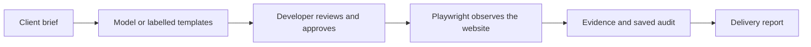

# Briefstamp

Turn a client brief into approved browser checks and a proof-of-delivery report.

Formerly FlowProof; existing repository and demo URLs are retained.

[](https://github.com/himanshu748/flowproof-web/actions/workflows/audit.yml) [](LICENSE)


[Try the live demo](https://flowproof-demo.onrender.com/#demo) · [Three-minute judge guide](docs/JUDGE_GUIDE.md) · Video: pending publication

## The problem

A finished website still leaves a freelancer explaining whether it meets the brief. Screenshots, test notes and handoff documents take time to assemble. Briefstamp connects each agreed requirement to an approved assertion, an observed browser result and a portable client report.

## How it works



## Measured results

The same approved **CI fixture plan** detected four regressions and four recoveries. [Recorded execution](docs/evidence/ci-regression-2026-10-15.json).

| Fixture state | Passed | Failed | Unverified |
|---|---:|---:|---:|
| Healthy | 5 | 0 | 1 |
| Intentionally broken | 1 | 4 | 1 |
| Restored | 5 | 0 | 1 |

The actual live homepage separately passed five checks; a deliberately wrong heading expectation failed. Both audits round-tripped through Tiger. [Live-site receipt](docs/evidence/hosted-website/2026-10-15T12-19-58Z/receipt.json).

Tinker LoRA used **69.55% fewer input tokens** than few-shot on the frozen 24-example comparison, while reference agreement fell from **23/24 to 22/24**. [Exact cost/quality tradeoff](docs/MODEL_RESULTS.md).

[Release CI](https://github.com/himanshu748/flowproof-web/actions/runs/38731823339): **436 application tests, 19 Python tests, build and real browser checks passed** for deployed revision `816d869e`.

## Integrations with receipts

- **Gemma:** a dated hosted run generated six unapproved checks. [Proof](docs/PUBLIC_GEMMA.md).
- **Mastra:** two actual workflow steps generated and validated that proposal. [Proof](docs/PUBLIC_GEMMA.md).
- **Tinker:** real baseline/LoRA evaluation and one protected hosted proposal. [Proof](docs/HOSTED_TINKER.md).
- **Tiger Data:** strict-TLS audit persistence, matching reads and scoped lexical retrieval. [Proof](docs/TIGER_VERIFICATION.md).
- **Sentry:** the hosted proposal’s three spans were independently found in its dashboard. [Proof](docs/SENTRY_HOSTED.md).
- **Backboard:** one protected hosted write/search recovered all six audit facts. [Proof](docs/BACKBOARD_VERIFICATION.md).
- **Temporal:** a hosted CI restart retained the same workflow/run and one browser execution. [Proof](docs/TEMPORAL.md).

## Run locally

```sh
npm ci --legacy-peer-deps
npx playwright install chromium
npm run dev
```

Open http://127.0.0.1:5173. The default sample needs no paid account. [Configuration and deployment](docs/DEPLOYMENT.md).

## Limitations

- Public targets are the owned homepage and sample; scripts are disabled. The public sample’s plan yields three failures, versus four in the CI fixture.
- Current live-site proof used labelled templates after Gemma failed upstream HTTP 500. Earlier AI success is separately dated.
- Tinker used fewer tokens with lower reference agreement; the dataset has no human-validated examples.
- Credit-funded services expire. Tiger stores image references only; operator budgets and visitor sessions are bounded.
- No customer acceptance or all-sponsor completion is claimed. [Full scope and remaining gates](docs/PRD_STATUS.md).

## AI disclosure

AI coding assistance helped build Briefstamp. Model proposals require approval; deterministic browser execution supplies the results. Retained test approvals came from a verification harness, not a customer. The submission remains a draft for the author to review and publish.
