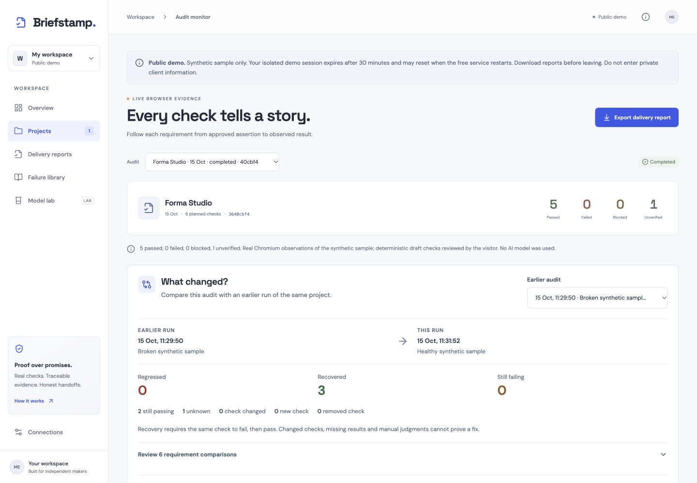

# Briefstamp

Previously FlowProof. The existing repository, demo URL and storage identifiers are retained for compatibility.

Turn website requirements into approved browser checks and evidence-backed delivery reports.

[Live demo](https://flowproof-demo.onrender.com) · [Browser acceptance workflow](https://github.com/himanshu748/flowproof-web/actions/workflows/audit.yml) · [Evidence and limitations](docs/DEPLOYMENT.md)

The landing page introduces the workflow with original conceptual artwork and a labelled interactive sample. Choose **Open demo** to enter the real workspace. For a short review path, see [the entry evidence guide](docs/HACKATHON_ENTRY.md). See the [requirement-by-requirement PRD status](docs/PRD_STATUS.md) for completed capabilities and remaining gaps.

Briefstamp includes a local working product and an isolated public-demo mode. It includes a React delivery cockpit, safe typed acceptance checks, a real Playwright runner, screenshot and redacted text evidence, standalone HTML reports, PostgreSQL persistence, failure retrieval, and a GitHub Actions workflow. Integration readiness and measured model results are shown honestly in the app. Audits capture the original brief, target and generator at run time. Incomplete exports retain every planned requirement and disclose missing evidence.

Real Tinker baseline and LoRA runs are now recorded using confirmed promotional credits. On the same 24-example holdout, few-shot prompting achieved **23/24 reference matches and 19/20 correct healthy/broken browser pairs**; LoRA achieved **22/24 and 18/20**. Fine-tuning did not beat the strongest baseline. This 96-example synthetic pilot was agent-reviewed, with **zero human-validated examples**. See [measured results](docs/MODEL_RESULTS.md).

A real strict-TLS probe on a confirmed no-card Tiger trial verified the application store end to end: two projects, two audits, ten recovered screenshots, and lexical/vector retrieval over four failures. A fresh process recovered evidence from Tiger with an empty local directory, and an independent read confirmed temporary-schema cleanup. **The separate Shared Free service remains TLS-blocked, and the public demo has no database connection.** See [Tiger evidence and boundaries](docs/TIGER_VERIFICATION.md).



Actual local UI after three browser audits. The public brief plan shows three recoveries; the separate CI fixture plan asserts four regressions and recoveries.

## Run locally, no paid account required

```sh
npm ci --legacy-peer-deps
npx playwright install chromium
npm run dev
```

Open http://127.0.0.1:5173. The server listens only on loopback by default. With no configuration, data persists to `data/state.json`. The sample site is served through browser routing and makes no network requests.

1. Choose **Open demo**, then open the Forma Studio sample.
2. Review the proposed checks. Edit any interpretation and approve the checks.
3. Run the audit and inspect the actual screenshots and observed text.
4. Switch the sample to the broken version, reapprove and run again.
5. Switch back to healthy, reapprove and rerun. **What changed?** compares the same assertions across audits. Changed expectations, manual judgments and missing results cannot count as a fix.
6. Download a portable HTML report with embedded screenshots. Use the browser print dialog for PDF.

The welcoming/trustworthy requirement is intentionally unverified, because a deterministic browser assertion cannot establish it.

## Verification

```sh
npm run verify
npm run audit:plan -- briefstamp-plan.json
```

`audit:sample` executes healthy, broken and restored-healthy sample states in Chromium with the same approved fixture plan. It requires four regressions and four recoveries, while the subjective requirement stays unverified. Each run exports JSON, screenshots and a standalone HTML report; CI also writes a readable job summary. Unit tests exercise schema and network guards. A saved approved plan can run in GitHub Actions. CI stores screenshots and audit JSON as artifacts. Current remote execution evidence is tracked in [deployment evidence](docs/DEPLOYMENT.md).

## Optional configuration

Copy `.env.example` to `.env`. Keep it private. The app loads `.env` through Node's environment loader.

- **PostgreSQL:** set `DATABASE_URL`. TLS certificate verification is enabled; only trusted local PostgreSQL should set `DATABASE_SSL=false`. The app creates dedicated `flowproof_*` tables. It is a single-process MVP: run one replica. Audit evidence is persisted as database byte arrays after a completed run, so downloaded reports can survive an ephemeral host restart. The separate Shared Free Tiger service fails strict certificate verification; its direct adapter remains blocked. The successful no-card trial probe was isolated and temporary. Do not disable verification or upgrade to bypass the Shared Free limitation.
- **Local open model:** run Ollama with a supported completion model, set `FLOWPROOF_AI_ENABLED=true`, `FLOWPROOF_OLLAMA_MODEL=gemma3:4b` (or your installed Qwen model). Every plan records its actual provider. Invalid responses fall back to an explicitly labeled conservative rule parser. There is no default remote AI billing path. A real three-requirement Gemma workflow produced a failed heading and then recovery, with nine screenshots and grounded commentary; two full-brief attempts timed out. See [Gemma evidence](docs/GEMMA_WORKFLOW.md) and reproduce with `node --import tsx scripts/verify-gemma-workflow.ts --run-local-model --supported-brief`.
- **Failure vectors:** with PostgreSQL and local `all-minilm:22m`, set `FLOWPROOF_EMBEDDINGS=true`. Failure descriptions are embedded locally and searched using actual cosine similarity plus lexical ranking in PostgreSQL. The portable array implementation uses a full scan appropriate to a small demo. It does not claim pgvector acceleration.
- **Tinker:** see [measured results](docs/MODEL_RESULTS.md) and [reproduction instructions](docs/MODEL_EVALUATION.md). Recorded baseline, training and paired-browser receipts are bundled. New provider work requires independently confirmed free credits and shared token/cost budgets. A [real one-heading operator workflow](docs/TINKER_WORKFLOW.md) passed the approval boundary and healthy/broken/restored browser checks through a fresh Tinker sampler. It uses a verified no-thinking Qwen template at the raw endpoint; the earlier rejected chat-mode attempts remain recorded. This is separate from the quality benchmark. The public demo never calls Tinker.

- **Mastra and Sentry:** real SDK coordination and sanitized local trace envelopes are demonstrated in [the orchestration proof](docs/ORCHESTRATION_OBSERVABILITY.md). Private operator routes use Mastra; the free public sample uses the direct bounded browser runner to fit its memory limit. Hosted Sentry ingestion remains unverified.
- **Temporal:** opt-in local durable audits passed real retry and server/worker restart checks; [setup and proof](docs/TEMPORAL.md). No paid cloud worker is required or claimed.
- **Other providers:** [SerpApi’s real Free-plan search](docs/evidence/serpapi/2026-10-15T07-38-38-984Z/receipt.json) and [Entire’s scoped local import/readback](docs/ENTIRE.md) have receipts. Backboard memory and ElevenLabs synthetic narration have guarded operator adapters; [live verification gates](docs/ALL_INTEGRATION_GATES.md) remain explicit.

## Hosting and operating boundaries

`render.yaml` and `Dockerfile` define a **free** Render web service with Chromium and its Linux dependencies. No database, paid worker, persistent disk or model API is required. Deployment evidence is tracked in [docs/DEPLOYMENT.md](docs/DEPLOYMENT.md).

**Public demo:** `FLOWPROOF_PUBLIC=true` and `FLOWPROOF_DEMO=true` enable isolated visitor sessions. Only the synthetic sample can be audited. Draft generation uses a clearly labelled deterministic parser. Model lab displays recorded experiment receipts without calling Tinker. Sessions expire after 30 minutes and disappear on service restart; download reports before leaving. The demo allows 20 simultaneous sessions, four audits per visitor, one running audit at a time and 24 audits per hour. Do not enter private client information. Local databases, models and operator data are never loaded in this mode.

**Private operator mode:** Public hosting without `FLOWPROOF_DEMO=true` requires an operator token of at least 32 characters. Enter it in app Settings. This mode has no multi-user account system. A configured database is required to retain projects and completed evidence across ephemeral-host restarts. Local Ollama is not reachable from a cloud service.

Free Render services sleep after inactivity and have shared monthly limits. Auto-deploy is disabled in the supplied blueprint so deployments can follow verified CI. Never upgrade the plan or attach paid resources to work around free-tier limits.

## Safety and limitations

External audits require explicit owner/authorized-auditor attestation, HTTPS public destinations and reviewed checks. The runner pins validated IPs, validates every redirect, denies private networks and non-GET requests, restricts requests to the original origin, blocks JavaScript, service workers and WebSockets, and bounds resource usage. It never submits forms or runs model-written browser code. These constraints intentionally make some JavaScript-heavy websites untestable; results must be blocked or unverified rather than fabricated passes.

Client input, URLs, captured text, logs and screenshots require careful handling. The runner redacts common credential and personal-information patterns and masks form controls. Automated redaction cannot establish that every private detail is removed; review evidence before sharing. HTML reports escape captured text. No client telemetry is sent to sponsors.

Planned sponsor integrations are not counted as functioning integrations. The public evidence is in [deployment evidence](docs/DEPLOYMENT.md), plus the app's connection and evaluation screens. Private local build receipts are retained separately. See [integration status](docs/INTEGRATIONS.md).
