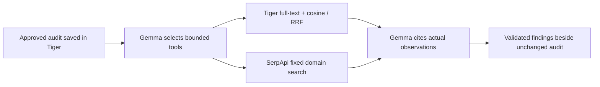

# Tiger Data and SerpApi evidence agent

**Earlier operator flow verified October 16, 2026.** A real native Gemma turn selected both tools; the second turn consumed their actual observations and cited the returned facts. [Complete verifier receipt](evidence/hosted-evidence-agent/2026-10-16T12-14-14Z/receipt.json) · [Actual agent selection, observations and model output](evidence/hosted-evidence-agent/2026-10-16T12-14-14Z/agent-run.json).

**Earlier verification under the original 12-run cap:** [four retained public attempts](evidence/judge-agent/2026-10-16T13-07-24Z/receipt.json) leave **eight of twelve shared slots** at 13:42 UTC. One tokenless HTTP run completed both tools and model turns. The latest in-app browser attempt returned Google HTTP 500 `INTERNAL` before tool selection; the earlier browser search timeout remains unknown upstream. No successful complete agent screen was observed in the in-app browser. Provider reliability remains unresolved. [Earlier source and green CI](evidence/judge-agent/2026-10-16T13-07-24Z/search-wait-deployment.json) · [390px recovery QA](evidence/judge-agent/2026-10-16T13-07-24Z/ui-qa.json).


The run used deployed source `f990d9a14ae95dc322e4d81a411e9dd764ff9207`, which passed [CI](https://github.com/himanshu748/flowproof-web/actions/runs/38898518897): **871 application tests, 19 Python tests, build and real browser audits**. CI does not call the live models or search provider; the dated hosted receipt is separate evidence.

The bounded agent reviews one unchanged, approved broken synthetic audit and Briefstamp's fixed owner-authorized homepage. It uses native Google-hosted Gemma **text JSON**, not provider-native function calling, a Mastra Agent or the separate Mastra check-proposal workflow. The server validates selected read-only tools and their arguments, then sends only typed observations into the second turn. Findings must cite exact returned audit/check or observation IDs. Server-rendered factual prose remains separate from actual model JSON.



## Public judge grant architecture

**Public judge flow verified:** [open the evidence agent](https://flowproof-demo.onrender.com/#agent), approve the fixed checks, run Chromium, then consent to Gemma selecting Tiger history and SerpApi search. [Actual public-route receipts](evidence/judge-agent/2026-10-16T13-07-24Z/) retain both a complete tokenless run and the earlier upstream model failure; the four old operator allowances remain spent.

The new [judge walkthrough](JUDGE_GUIDE.md#optional-public-evidence-agent) prepares the fixed broken sample, requires an explicit approval action, runs the real browser audit and verifies exact Tiger JSON readback before separate model/search consent. `POST /api/audits/:id/judge-review` requires the exact HTTPS Briefstamp origin and the owning visitor cookie, without an operator token. `GET /api/judge-agent/status` reads availability and only that visitor's saved result; it never replays model or search work.

The original immutable Tiger grant retains its **12-run base seal**. An append-only expansion raises the total to **100 runs on the same grant**, preserving every spent slot and the original proof. The limits remain **six judge runs per hour** and **one run per visitor session**, with **two physical model requests and one search maximum per run**. The existing shared 12-model-request hourly cap also includes proposal work. A transaction commits the unique visitor/slot reservation before provider I/O. Its append-only result can be read after a lost response; failure or ambiguous commit does not refund the slot. Session ownership, current source snapshots, free funding and expiry are rechecked across awaited operations. No model call is triggered merely by opening the page.

The [reviewed additive SQL](hosted-tiger-judge.sql), [grant gate](../server/judge-agent-gate.ts) and [HTTP regression tests](../tests/demo-judge-agent.test.ts) define the public path. Grant/counters live in Tiger, so Render restarts cannot reset them; visitor sessions and image bytes remain ephemeral. The grant ends no later than **October 20, 2026 at 00:00 UTC**, alongside existing Tiger access restrictions. The existing four spent operator tranches and standalone search proof are pinned and preserved, not repurposed as public capacity. The fixed-vector retrieval and native Gemma limits below are unchanged; the linked dated public receipts establish execution separately from the code and offline tests.

## What the hosted model actually consumed

| Phase             | Actual native request | Reported input / output tokens | Retained result                                                                                 |
| ----------------- | --------------------- | -----------------------------: | ----------------------------------------------------------------------------------------------- |
| Select tools      | One HTTP 200          |                       517 / 38 | `failure_history` with `mobile_paraphrase`, then `search_visibility` with no supplied arguments |
| Cite observations | One HTTP 200          |                    1,242 / 735 | Three matching saved failure citations and a search snapshot citing `resultCount: 0`            |

Both responses included exact whole JSON fences and empty thought parts. Their removal is recorded as transport normalization; generated fields were not repaired. Request/response hashes, reported model version and per-attempt usage are retained. No retry occurred in this run.

Tiger returned **three saved failures** from the same source audit. The mobile-overflow result ranked first for “sideways panning on smartphones,” with **cosine 0.3781263417931506**, lexical score **0** and no lexical rank. PostgreSQL combined available full-text and cosine ranks with reciprocal rank fusion. A [separate calculation](evidence/hosted-evidence-agent/2026-10-16T12-14-14Z/independent-cosine.json) matched the SQL cosine values. The [paraphrase lexical control](evidence/hosted-evidence-agent/2026-10-16T12-14-14Z/lexical-control.json) returned no matches; the [positive `horizontal` keyword control](evidence/hosted-evidence-agent/2026-10-16T12-14-14Z/lexical-positive-control.json) returned one. The second model turn cited the actual retrieved audit/check IDs and failed statuses. This demonstrates retrieval serving the agent, not general search quality or independent customer history.

The [SerpApi transport](evidence/hosted-evidence-agent/2026-10-16T12-14-14Z/serpapi-transport.json) returned **HTTP 200 in 379 milliseconds**. Its [actual response](evidence/hosted-evidence-agent/2026-10-16T12-14-14Z/serpapi-search.json) contained **zero matching results**. The second model turn consumed that observation and cited the exact zero count. This establishes a search tool used in the bounded agent loop, not de-indexing, ranking, an uncached-freshness guarantee or a passing browser assertion.

The [source Chromium audit](evidence/hosted-evidence-agent/2026-10-16T12-14-14Z/source-audit.json) remained **2 passed, 3 failed, 0 blocked and 1 unverified**, with unchanged approval states. A duplicate tranche was rejected with **409**; tokenless and cross-visitor access with **404**; missing consent with **400**. The approval belongs to an automated synthetic verifier, not a customer.

## Retrieval scope

The [catalogue](../shared/agent-retrieval-vectors.json) contains genuine normalized **384-dimensional** `all-minilm:22m` embeddings for three exact failure texts from a real Chromium audit. The [generation script](../scripts/generate-agent-retrieval-catalog.ts) uses the already-installed local model; no paid embedding endpoint is required. Exact text hashes bind every vector to its source observation. Unsupported failure texts are skipped, never given fabricated embeddings.

Only **three precomputed query vectors** are supported. Vectors use PostgreSQL arrays, **not pgvector**. This is a fixed-query integration demonstration, not arbitrary hosted embedding inference or a retrieval-quality benchmark. The [additive migration](hosted-tiger-agent.sql) adds scoped embedding/reservation tables. The runtime retains restricted SELECT/INSERT access, strict TLS and the **October 20 access cutoff** on the credit-covered Tiger trial; permanent free storage is not claimed.

## Search and agent boundaries

The model cannot choose a URL, SQL, script, request header, project ID, domain or external destination. SerpApi observes only `site:flowproof-demo.onrender.com` through the exact allowlist. No result links are followed. Search titles/URLs, private briefs, DOM, project names and credentials do not enter the model context. A failed lookup remains unavailable, distinct from a successful empty response. Every finding is checked against actual observations before display; tool output cannot authorize another action or change the source audit.

## Consumed allowance and failure history

The successful tranche reserved **two free Gemma requests and one free SerpApi search**, without retry or refund. Its search deadline was explicitly bounded to **30 seconds** within a **90-second** global deadline; this did not increase model-call or search quotas. The full reservation is consumed. Earlier reservations remain spent. Fresh account observations, allowance timestamps and server restarts do not authorize additional calls. [Funding boundaries](PROVIDER_ALLOWANCES.md).

For the recorded operator proof, before provider I/O the verifier reserves an exclusive off-host record and the app inserts the tranche into Tiger under a global UNIQUE key. That route requires the operator token, explicit model consent, visitor ownership, exact approved synthetic checks, matching Tiger readback and shared model/browser locks. Cancellation, expiry and source changes fail closed. Billing settings, FieldIssue data and access durations were not changed.

Earlier attempts remain visible: [HTTP 200 with invalid model JSON](evidence/hosted-evidence-agent/2026-10-16T11-30-58Z/README.md), [upstream HTTP 500 / INTERNAL](evidence/hosted-evidence-agent/2026-10-16T11-44-46Z/README.md), and [a partial run whose search timed out at 10 seconds](evidence/hosted-evidence-agent/2026-10-16T11-59-52Z/README.md). The last of those genuinely cited Tiger rows but received no search response; upstream search completion remained unknown. The later successful run does not relabel earlier failures or replace their receipts.

```sh
# Dry run: no credential reads or requests.
node --import tsx scripts/verify-hosted-evidence-agent.ts
```

Actual `--run` requires a separately approved allowance, private prepared access file, exact verified deployment SHA and unused off-host tranche. Do not delete spent state to repeat a proof.

## Community references

[Hybrid retrieval in one Postgres query: RRF over tsvector + pgvector, vinay_kumarks_9d8ca4e45](https://dev.to/vinay_kumarks_9d8ca4e45/hybrid-retrieval-in-one-postgres-query-rrf-over-tsvector-pgvector-2hm) informed the ranking approach; Briefstamp uses arrays rather than that post's pgvector path. [Tool output is untrusted input, loopandretry](https://dev.to/loopandretry/tool-output-is-untrusted-input-prompt-injection-is-a-data-flow-bug-1p9j) informed the fixed destinations and separation of observations from action authority.

The [October 16 allowance check](evidence/judge-agent/2026-10-16T14-14-32Z/funding.json) confirmed enough existing free search capacity for the owner-approved **100-total-run expansion**, with the same grant UUID, four spent judge slots and 96 remaining at that check. The base grant, all prior reservations, six/hour, one/session, per-run request limits and October 20 cutoff remain unchanged; no model or search request was made by that check. [Refreshed no-card Tiger trial boundary](evidence/judge-agent/2026-10-16T14-14-32Z/tiger-funding.json).

[Live expansion readback](evidence/judge-agent/2026-10-16T14-14-32Z/verification.json) confirmed **100 total / four spent / 96 remaining**, unchanged original grant and results, and HTTP 200 for `/#demo`. The [in-app browser copy check](evidence/judge-agent/2026-10-16T14-14-32Z/ui.json) observed the optional placement and a 390px layout without page overflow. These checks made no model or search calls and do not resolve the retained upstream provider failures.
