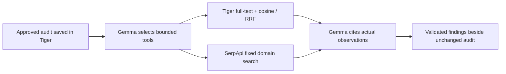

# Tiger Data and SerpApi evidence agent

**Implementation and offline tests prepared; hosted model/tool proof pending.** The historical storage and standalone search receipts do not establish this new agent flow. Category claims will be updated only after the deployed flow succeeds.

The bounded evidence agent reviews one unchanged, approved broken synthetic audit and Briefstamp's fixed owner-authorized homepage. A native Google-hosted Gemma text turn proposes zero to two typed tool requests. The server validates the selection, executes only the chosen read-only tools, then sends their actual typed observations to a second Gemma turn. Findings must cite exact returned audit/check or observation IDs. A failed or empty lookup has its own state. Browser results and approvals remain unchanged.



## Retrieval scope

The [catalogue](../shared/agent-retrieval-vectors.json) contains genuine normalized 384-dimensional `all-minilm:22m` embeddings for three exact failure texts from a real Chromium audit. The [generation script](../scripts/generate-agent-retrieval-catalog.ts) uses the already-installed loopback model; no model download or paid embedding endpoint is required. Exact text hashes bind every vector to its source observation. Unsupported failure texts are skipped, never given fabricated embeddings.

Only three precomputed query vectors are supported. Parameterized SQL combines PostgreSQL full-text ranks and cosine ranks with reciprocal rank fusion. Vectors use PostgreSQL arrays, **not pgvector**. This is a fixed-query integration demonstration, not arbitrary hosted embedding inference or a retrieval-quality benchmark. The [additive migration](hosted-tiger-agent.sql) adds two scoped tables; the runtime gets SELECT/INSERT only, with existing strict TLS and October 20 cutoff.

## Search and agent boundaries

The model cannot choose a URL, SQL, script, request header, domain or external destination. SerpApi observes only `site:flowproof-demo.onrender.com` through the existing exact allowlist. No result links are followed. Search titles/URLs do not enter the model context; the bounded domain, query, observed timestamp and actual result count do. Zero matching results is not proof of de-indexing or a passing browser check.

The agent uses native text JSON for selection and findings, not provider-native function calling or the separate Mastra proposal workflow. All typed findings are checked against actual observations; the factual prose summary is server-rendered from validated data and is labelled separately.

## One-shot free-resource proof

The owner's October 16 request authorizes a separately prepared tranche: at most two free Gemma requests and one free SerpApi search, without retry/refund. The old one-search allowance remains consumed and its exact bytes/hash are bound into the new proof. A fresh read-only SerpApi account observation confirms the existing Free Plan; the model path independently verifies Google's free-only pricing.

Before any model/search I/O, the verifier reserves an exclusive off-host record and the app inserts the tranche into Tiger under a global UNIQUE key. A deployment cannot reset that row. The route requires the existing operator token, explicit model consent, visitor ownership, exact approved synthetic checks, matching Tiger readback and shared model/browser locks. Expiry and source changes fail closed. No additional credentials, billing settings, services, FieldIssue data, or access durations change.

Dry-run command, which makes no requests:

```sh
node --import tsx scripts/verify-hosted-evidence-agent.ts
```

Actual `--run` requires the private prepared access file, exact verified deployment SHA and unused off-host tranche reservation. Do not delete spent state to repeat a proof. [Provider boundaries](PROVIDER_ALLOWANCES.md).
