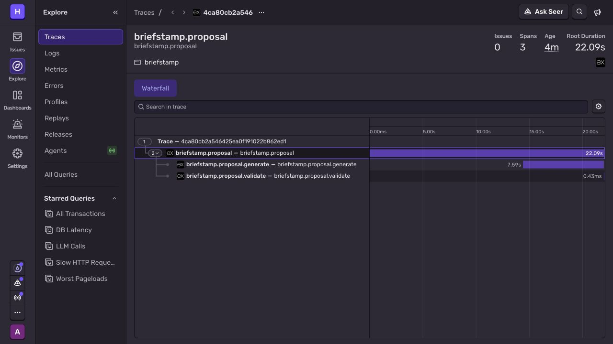

# Sentry: verified hosted proposal trace

**One real hosted proposal trace was verified in Sentry’s authenticated dashboard on October 15, 2026.** This is separate from the earlier SDK local-transport tests. [Dashboard verification receipt](evidence/hosted-open-model/2026-10-15T10-55-27Z/sentry-verification.json) · [Actual application run](evidence/hosted-open-model/2026-10-15T10-55-27Z/receipt.json).

The run used source `e43dbe7430368292ff9b225f4bf5e3236c2d03c0`, [successful CI](https://github.com/himanshu748/flowproof-web/actions/runs/38722793847), and the existing Free Render deployment `dep-db8b0ebncjis73f93b3g`, live at 10:53:13 UTC. Native Gemma generated the fixed synthetic proposal; the verifier later approved its checks and completed healthy/broken/restored Chromium audits. The trace concerns proposal generation, not those browser audits.

## What was independently observed

Trace `4ca80cb2a546425ea0f191022b862ed1` appeared in the separate Briefstamp project with:

- `briefstamp.proposal`: root status `ok`, 22.09 seconds.
- `briefstamp.proposal.generate`: 7.59 seconds.
- `briefstamp.proposal.validate`: 0.43 milliseconds.

The application recorded 335 input / 300 output tokens and 7.502 seconds for its native Gemma provider/validation call, not the entire hosted workflow. These measurements cover different operations; they are one-run observations, not a latency benchmark. Maximum resident memory of the isolated Mastra/Sentry worker was 175.07 MiB.

The worker’s own result deliberately retains `ingestionVerified: false`: it can know that it flushed, but it cannot confirm what appeared in the provider dashboard. The separately retained dashboard receipt establishes ingestion for this exact trace. The original application receipt is not rewritten to claim that knowledge.

## Privacy and resource boundary

The real Sentry SDK is loaded only in the isolated proposal worker when explicitly enabled with a fresh, at-most-24-hour funding confirmation. Disabled or stale configurations do not load it. Each child caps delivery at three envelopes; the public model-request quotas provide the wider execution bound.

The final transport allowlist retains fixed operation names, trace/span identifiers, timing/status and bounded check counts. It excludes client briefs, model output, cookies, credentials, screenshots, attachments and raw diagnostic messages. Sentry can derive hosting-server metadata from its own ingestion request. Local SDK tests verify parent/child trace identity and private-field exclusion.

A sponsored entitlement with paid overage disabled was verified before configuration. No billing or FieldIssue settings changed. This does not establish browser-audit tracing, error-event ingestion, indefinite entitlement or all-provider observability. Further hosted use still requires a fresh confirmation and the same bounded configuration.

Sources: [child workflow](../server/gemma-workflow-child.ts), [privacy transport](../server/observability.ts), [earlier local SDK proof](ORCHESTRATION_OBSERVABILITY.md), [deployment ledger](DEPLOYMENT.md).
