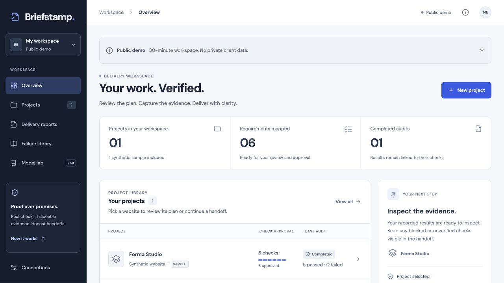
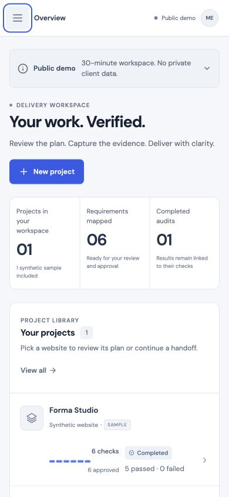

# Dashboard release proof — October 16

Deployed source: `4d8f7fd2440d68f795cdc3da42d0fa362bf8552d`. The existing Free Render service and its consumed provider allowances were preserved.

| Record | What it establishes |
|---|---|
| [CI](ci.json) | 571 application tests, 19 Python tests, build, real public-runtime and healthy/broken/restored fixture audits. |
| [Deployment](deployment.json) | Exact green source became live; Free plan and unchanged hosting environment read back. |
| [Local UI](local-ui.json) | Completed Chromium workflow and report download, seven screens, widths 1440/768/390/360, no captured page errors. |
| [Hosted UI](hosted-ui.json) | Actual in-app browser approval, sample audit, Tiger save confirmation, report download, populated overview and mobile keyboard checks. |
| [Portable report](hosted-report.html) | Actual hosted template sample: 5 passed, 0 failed, 0 blocked, 1 unverified, with embedded evidence. |
| [File hashes](manifest.json) | SHA-256 and byte lengths for the retained files. |

The hosted check used labelled templates and made no model request. A temporary “Failed to fetch” alert appeared during polling; later completion, Tiger confirmation and report download succeeded. The cause was not established. These are agent checks, not customer acceptance or exhaustive accessibility testing. Earlier model and sponsor runs keep their original source revisions.

## Actual deployed desktop

## Actual deployed mobile

