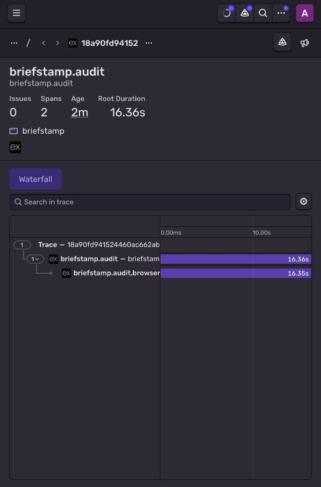
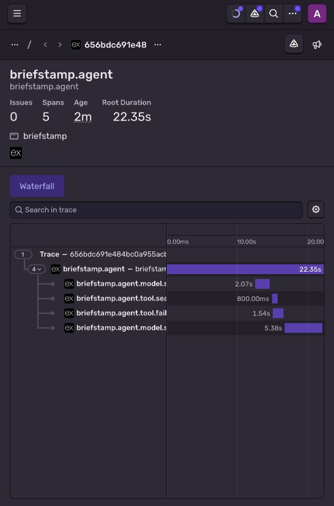

# Hosted Chromium and agent tracing — October 17

Source `72e8a15e324b4702833b34ca4a116da8deba4a75` ran on the existing Free Render service. [Application receipt](receipt.json) · [Dashboard sidecar](sentry-verification.json) · [Exact source CI](ci.json) · [Deployment](deployment.json).

| Actual hosted operation | Dashboard observation |
| --- | --- |
| Chromium audit | Trace `18a90fd941524460ac662abb0b84dd9e`: two spans, 16.36-second root, status `ok` |
| Mastra Agent | Trace `656bdc691e484bc0a955acb778df323e`: five spans, 22.35-second root, status `ok` |
| Gemma selection | Provider HTTP 200, 535 input / 34 output tokens; 1,969 ms provider duration |
| Gemma summary | Provider HTTP 200, 1,266 input / 562 output tokens; 5,273 ms provider duration |
| Tiger and SerpApi | Both tools observed; three historical failures and zero search matches; seven validated findings |
| Browser result and storage | 2 passed / 3 failed / 0 blocked / 1 unverified; exact Tiger round-trip, unchanged by agent |
| Spending boundary | Four dedicated units, two exports; judge slots 4 before / 4 after; all 108 earlier records unchanged |

The two model requests used Backboard/OpenRouter `google/gemma-4-26b-a4b-it`, not a new Google inference. This was approved existing mixed credit, not a free-only debit claim. [Funding](funding.json) · [Consumed reservations](spent-reservations.json) · [Post-run free search account](search-account-observation.json).

[Browser trace](browser-trace.json) and [agent trace](agent-trace.json) preserve original measured timestamps, durations, actual token usage and SDK flush. Their `ingestionVerified: false` values remain untouched; the independent dashboard sidecar proves ingestion. The SDK ran in a short-lived child after each observed operation completed. Model span duration includes its bounded wrapper; provider duration is reported separately. Root `ok` means execution completed, not that failed assertions passed.

The dashboard retained model/provider and latency attributes. Its ingested model attributes did **not** contain the token-named fields: [sanitized actual dashboard projection](dashboard-model-attributes.json). Their omission's cause is unconfirmed. Token counts are verified against the actual provider receipt and application measurement, not claimed as independently dashboard-verified. No privacy, authentication, TLS, Sentry security or quota setting was weakened.

This is one operator-authorized synthetic proof, not automatic tracing of all anonymous visitors, error-event ingestion, continuous cross-process propagation, customer acceptance, or a latency benchmark. Unknown completion is never refunded. Every prior receipt remains history; these grants are consumed. No public judge slot, purchase, credential transfer, new service or billing change occurred. The public evidence route still uses Google.
