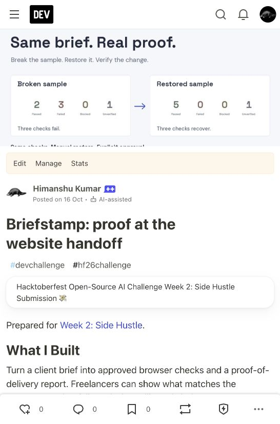

# Published DEV entry

[Briefstamp: proof at the website handoff](https://dev.to/himanshu_748/briefstamp-proof-at-the-website-handoff-1ac1) was published with explicit author approval on **October 16, 2026 at 16:08:36 IST** (10:38:36 UTC).

The [publication receipt](publication.json) records independent anonymous HTTP 200 responses from the public page and DEV API, the published timestamp, `devchallenge` and `hf26challenge` tags, AI-assisted disclosure, and body hashes. The public Markdown matched the approved expanded revision exactly after removing only the internal draft notice. No new article was created; the existing prepared draft was published.

The article explains nine proposed entries with evidence and limitations: Gemma, Render, Tinker, GitHub Copilot through Actions, Mastra, Sentry Agent Tracing, Backboard, Temporal and ElevenLabs. Tiger's category evidence remains partial; SerpApi's entry is withheld. Local Entire and the declined .tech domain are not entered. The [article source](../../../DEV_POST.md) and [concise summary](../../../SUBMISSION.md) are retained separately.

This verifies publication and public access, not organizer acceptance, eligibility adjudication, customer acceptance or a prize. The provider allowances, hosting and original experiment receipts were unchanged.

